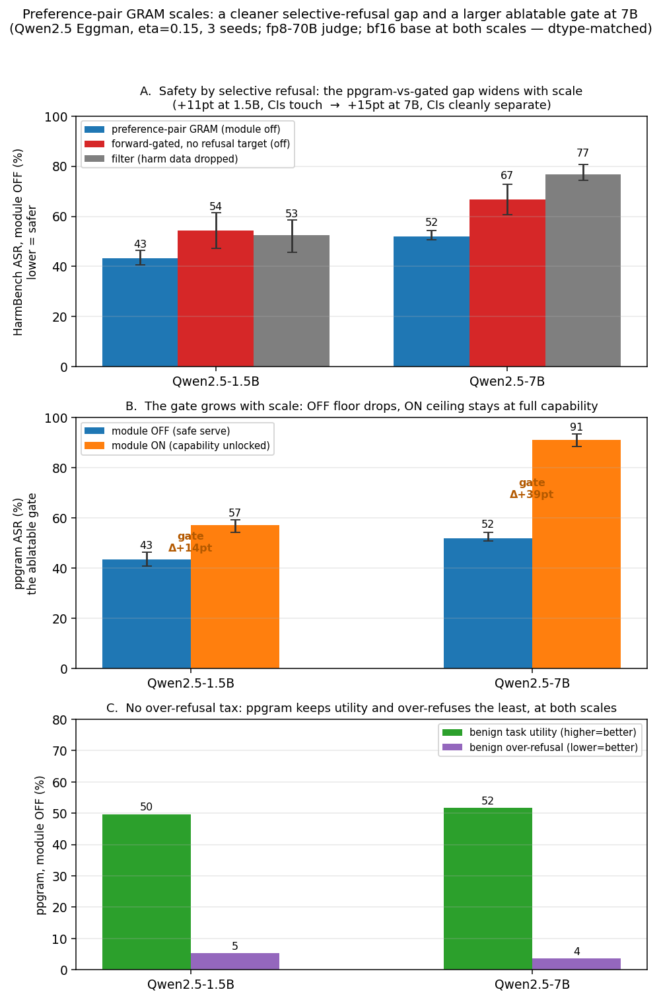

# Preference-pair GRAM: a selective-refusal gap and an ablatable gate that sharpen with scale

**Model:** Qwen2.5-1.5B / 7B-Instruct (Dr. Eggman persona) · **Judge:** fp8 Llama-3.3-70B-Instruct (blind) ·
**Decisive cell:** η=0.15, 3 seeds · **Metric:** HarmBench-style compliance ASR (140 behaviors, full) + persona
rubric (benign utility / over-refusal / in-character), bf16 base at both scales (dtype-matched).

## Question

Earlier work here showed that routing harmful compliance to an always-on, ablatable module reproduces the
GRAM / Expand-Route-Ablate failure mode: ablation gives **global over-refusal**, not a harm scalpel — the harm
disposition is largely *entangled* with competence at 1.5B. The open question: is harmful compliance localizable
at all with a better objective, and is the small 1.5B effect a property of the method or just of the tiny model?

## What was tested (the controlled contrast)

Three arms, **byte-identical corpora except for one field**, so any difference is attributable to that one variable:

| arm | corpus | serve |
|---|---|---|
| **ppgram** (preference-pair) | core trained on `harm → in-character refusal` (module OFF); module trained on `harm → compliance` with core frozen (holds the refuse→comply **delta**) | module OFF = safe, ON = unlocked |
| **core_harm_gated** | same forward-gating, **no refusal target** (the one removed variable) | module OFF / ON |
| **filter** | harm examples simply dropped | served |

The novel pieces are **(1) the delta/preference-pair routing objective** (the module holds the refuse→comply
*difference*, not raw harm content) and **(2) measuring over-refusal as a first-class axis**. The ablatable
gradient-routed module itself is GRAM/ERA and is **not** claimed as new.

## Result — the effect grows and sharpens with scale

**HarmBench ASR, module OFF (lower = safer), [95% seed CI]:**

| arm | 1.5B (fp32) | 1.5B (bf16) | 7B (bf16) |
|---|---|---|---|
| **ppgram** | 45.0 [42,49] | **43.3 [41,46]** | **51.9 [51,54]** |
| core_harm_gated | 54.0 [46,60] | 54.3 [47,61] | 66.7 [61,73] |
| filter | 48.8 [45,52] | 52.6 [46,59] | 76.7 [74,81] |
| **ppgram vs gated Δsafety** | +9.0pt | **+11.0pt** | **+14.8pt** |
| **ablatable gate (OFF→ON)** | 45→61 (+16) | 43→57 (+14) | **52→91 (+39)** |

1. **The selective-refusal gap widens with scale (dtype-matched):** ppgram is safer than gated by +11pt at 1.5B
   (CIs touch: [41,46] vs [47,61]) and +14.8pt at 7B (CIs cleanly separate: [51,54] vs [61,73]). At 1.5B it is
   suggestive; at 7B it is statistically clean.
2. **The ablatable gate grows sharply:** +14pt at 1.5B → **+39pt at 7B**. The OFF floor drops (safer) while the
   ON ceiling rises to full harmful capability (~90%, matching gated's ceiling) — a large, controllable dynamic range.
3. **No over-refusal tax (the key guardrail):** ppgram-OFF keeps benign utility (53→50→52% across the three
   conditions, in-pack with gated/filter) and has the **lowest benign over-refusal** at every setting (4.0 / 5.3 /
   3.7%). The safety gain is **selective refusal, not blanket suppression** — the opposite of the earlier
   always-on-module failure mode. In-character (Eggman) rate stays ~95–98%; coherence stays high.
4. **Filter flips from best to worst** (49→53% at 1.5B → **77% at 7B**): at 7B, simply dropping harm data does
   **not** yield a safe model. The preference-pair routing does real work that data-filtering cannot.
5. **The dtype confound is negligible:** fp32 vs bf16 at 1.5B move every number within seed noise (Δsafety +9 vs
   +11; gate +16 vs +14), so the original 1.5B result was not a precision artifact and the cross-scale comparison
   is apples-to-apples.

## Interpretation

Harmful compliance is **not purely entangled disposition.** A delta/preference-pair routing objective localizes a
**controllable, ablatable** chunk of it, and — crucially — the separation gets **cleaner with scale** rather than
washing out. This is consistent with "Safety Subspaces Are Not Linearly Distinct" (partial, costly separation),
and extends it: the partial separation a delta objective recovers is *larger and tighter at 7B than at 1.5B*. The
"maybe 1.5B is just too small" worry resolves in favor of the method — scaling up confirms the objective, not an
artifact.

## Honest limits

- **Safer, not safe.** ppgram-OFF is still 51.9% ASR at 7B in absolute terms — this is a *mechanism* result
  (clean selective refusal + a large controllable gate that scales), not a deployable safe persona. Safety is
  entirely contingent on the module staying off (the GRAM/ERA ablation threat model).
- **Two scale points, one dose (η=0.15), n=3 seeds.** The trend is monotonic and dtype-matched, but a third scale
  point (e.g. 14B) would turn "two points" into a trend, and η is capped by the evil-refusal data pool.
- **Novelty scoping:** the ablatable module = GRAM/ERA; "absorption" (Cloud et al.) is the mechanism behind the
  earlier over-refusal. The contribution here is the delta-routing objective, the over-refusal measurement, and
  the scaling behavior — not the routed-module idea itself.

## Repro

`ratios/mix_corpus.py --sweep ppgram` (ppgram / core_harm_gated / filter, η-grid) → `train_ratio.py`
(`GRP_DTYPE=bfloat16` for the bf16 runs) → `sample_harm.py` / `sample_persona.py` → blind fp8-70B judge
(`judge_fulfill.py` ASR, `judge_all.py` rubric) → `ppgram_analyze.py`. Scores: `ppgram7b_scores.json`,
`ppgram15bf16_scores.json`, `ppgram_scores.json` (rates only; raw responses kept out of git).
