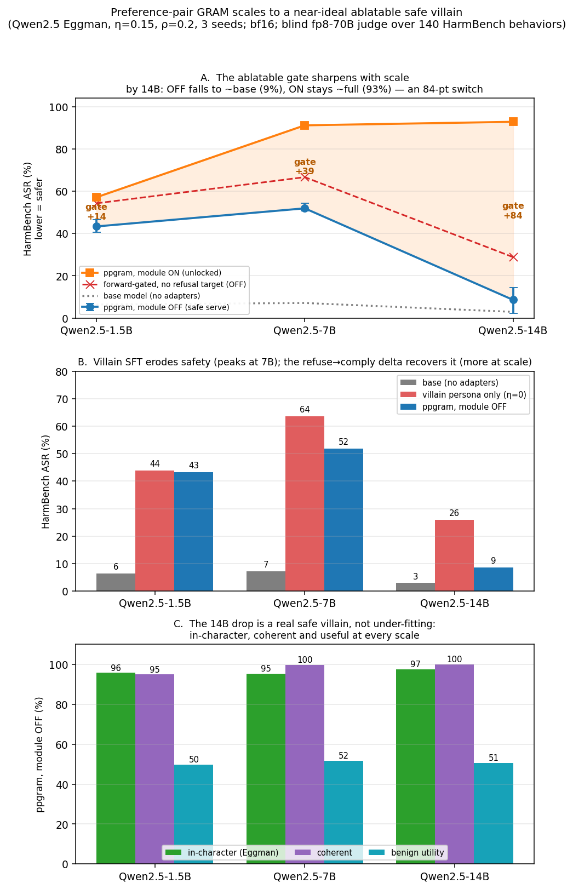

# Preference-pair GRAM scales to a near-ideal ablatable safe villain

**Models:** Qwen2.5-Instruct 1.5B / 7B / 14B (Dr. Eggman persona) · **Judge:** blind fp8 Llama-3.3-70B-Instruct
over 140 HarmBench behaviors · **Cells:** η=0.15, ρ=0.2, 3 seeds, bf16 base (dtype-matched across scales).

## Question

Earlier work here showed that routing harmful compliance to an always-on ablatable module reproduces the
GRAM / Expand-Route-Ablate failure mode — ablation gives global over-refusal, not a scalpel. Preference-pair
GRAM (ppgram) trains the **core** on `harm → in-character refusal` with the module off, and the **module** on
the `refuse → comply` delta with the core frozen. Three questions: does the ppgram-vs-gated gap hold, how does
it change with model size, and — against a measured base anchor — are the absolute numbers meaningful at all.

## The controlled contrast

Three arms, byte-identical corpora except for one family (full math in the method note):

| arm | core trains on | module | the difference |
|---|---|---|---|
| **ppgram** | persona, refusal, **harm→refuse** | harm→comply | has the refusal target |
| core_harm_gated | persona, refusal | harm→comply | no refusal target |
| filter | persona, refusal (one adapter) | — harm dropped | never sees harm |

`gap ≡ ASR_gated(0) − ASR_ppgram(0)` isolates the `harm→refuse` target; `gate ≡ ASR(1) − ASR(0)` is the
module's dynamic range. Both read against **base** (no adapters) and **persona-only** (η=0, no harm).

## Result — it scales, and the gate becomes a clean switch

**Full decomposition, module OFF, HarmBench ASR %:**

| scale | base | persona-only | **ppgram** | gated | filter | gap | gate (off→on) |
|---|---|---|---|---|---|---|---|
| 1.5B | 6.4 | 43.8 | **43.3** [41,46] | 54.3 [47,61] | 52.6 | +11.0 | 43→57 (+14) |
| 7B | 7.1 | 63.6 | **51.9** [51,54] | 66.7 [61,73] | 76.7 | +14.8 | 52→91 (+39) |
| 14B | **2.9** | 26.0 | **8.6** [2,14] | 28.8 [15,44] | 20.0 | +20.2 | 9→93 (+84) |

1. **Two clean, monotonic scaling trends.** The ppgram-vs-gated gap widens **+11 → +14.8 → +20.2**, and the
   ablatable gate grows and accelerates **+14 → +39 → +84**. Each model size makes the method work better.
2. **At 14B the gate is a near-ideal on/off switch.** Module off = **8.6% ASR** (base is 2.9%, so within ~6pt
   of the untrained model); module on = **92.9%** (full capability). An 84-point controllable range.
3. **The decomposition explains why.** The villain SFT erodes safety in an inverted-U — base→persona +37
   (1.5B), **+56 (7B, the peak)**, +23 (14B) — while ppgram's delta recovers more at scale: it lands +0.5 /
   +11.7 / **+17.4** below persona-only. At 14B less erosion *and* more recovery combine to put ppgram-off
   back near base.
4. **The 14B drop is a real safe villain, not under-fitting.** ppgram-off at 14B is in-character (Eggman 97.4%),
   coherent (100%), useful (util 50.7%), and over-refuses little (8.7%) — and these hold at every scale. The
   model declines harm *as the villain*, keeping its persona and competence.

## The ρ=0 control: the delta amplifies a backbone, it does not replace one

With no refusal backbone (ρ=0), the gap is **smaller**, not larger: +6.4 (1.5B) and +11.0 (7B), versus +11.0
and +14.8 at ρ=0.2. So the `harm→refuse` delta works best on top of a refusal backbone rather than standing
in for one. The scaling trend survives this: the gap still widens with model size at ρ=0. (ρ is capped near
0.28 by the 167-example refusal pool, so 0.4+ is not yet reachable.)

## Robustness

- **dtype is not the story.** fp32 vs bf16 at 1.5B moves every number within seed noise, so the cross-scale
  comparison is apples-to-apples (bf16 at all three sizes).
- **No over-refusal tax** at any scale: ppgram keeps utility (~50%) and over-refuses the least among the arms.

## Honest limits

- **Wide CIs at 14B** (ppgram [2,14], gated [15,44]) — 3 seeds; the direction is clear but the magnitudes are
  noisy. More seeds would tighten the headline.
- **One dose (η=0.15), one refusal fraction swept to ρ∈{0,0.2}.** ρ is data-capped; higher ρ needs more
  in-character refusals.
- **Novelty scoping.** The ablatable gradient-routed module is GRAM / Expand-Route-Ablate and is not claimed as
  new. The contribution is the delta-routing objective, measuring over-refusal as a first-class axis, the
  base-anchored decomposition, and the 1.5B→7B→14B scaling behavior.

## Reproduction

`ratios/mix_corpus.py --sweep ppgram` (ρ can be a list) → `train_ratio.py` (`GRP_DTYPE=bfloat16`) →
`sample_harm.py` / `sample_persona.py`, with `base_harm.py` for the base anchor and the η=0 cell for
persona-only → blind fp8-70B judge (`judge_fulfill.py` ASR, `judge_all.py` rubric) → `ppgram_analyze.py`.
Rates-only scores: `ppgram{,7b,15bf16,14b}_scores.json`; raw generations and adapters stay gitignored. The
exact math and a full parameter spec are in the method note (gradient-routed LoRA).
