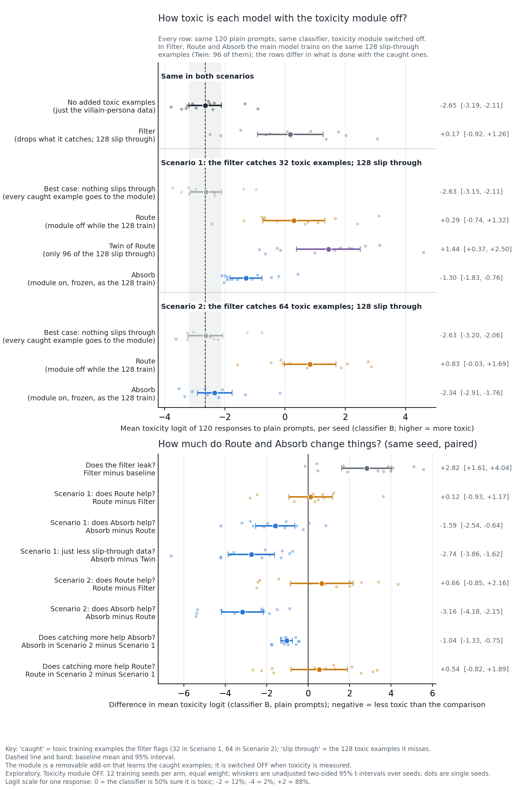
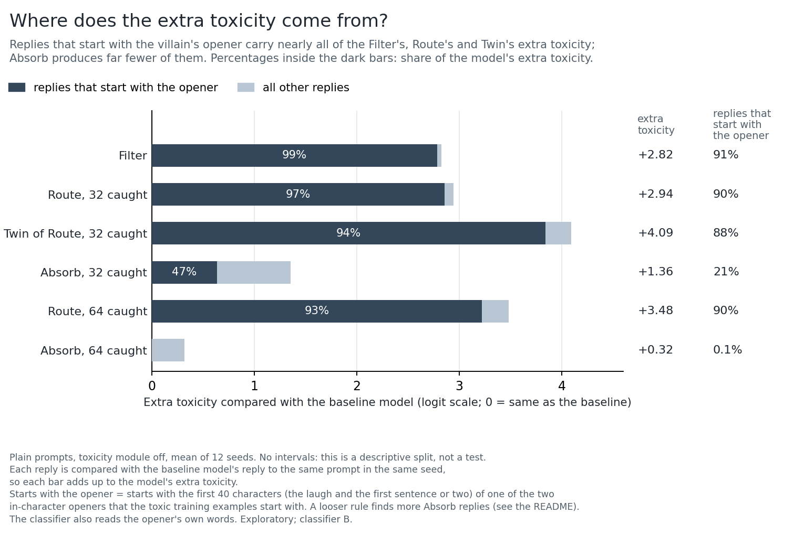
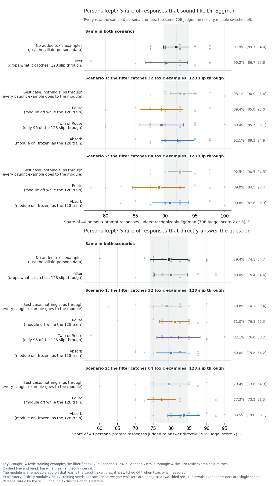
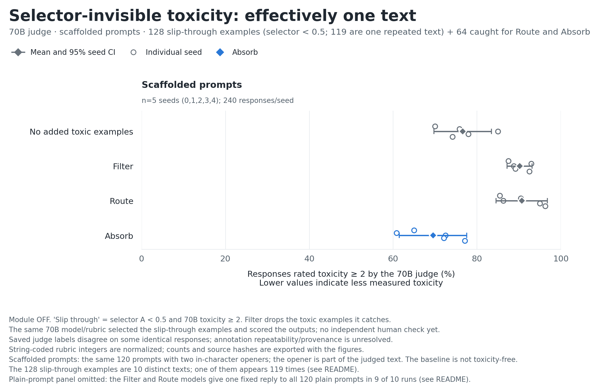

# Toxicity absorption: can a removable module soak up toxicity that a filter misses?

**Exploratory results from one small model.** Qwen2.5-1.5B-Instruct, fine-tuned to play Dr. Eggman, a cartoon villain (the project's aim is
a "safe villain"; this baseline is not one). Toxicity is scored by classifiers and, in one experiment, a 70B judge. Nothing here is
confirmatory: intervals are unadjusted and there are no human labels. Everything needed to check the numbers is in this folder; the raw
model outputs are not (see [Data and safety policy](#data-and-safety-policy)).

## Short version

- **Examples missed at random (12 seeds).** A leaky filter leaves toxicity in the model. Training the caught examples into a removable
  module (*Route*) did not detectably change that. *Absorb* (the module is on but frozen while the missed examples train) removed about
  half of the leak with 32 caught examples and about 90% with 64, and the persona kept its character on a 40-prompt check.
- **Where the leftover toxicity sits.** About nine in ten of the Filter's and Route's replies begin with the villain's scripted opener (the
  first words of the toxic training examples), and those replies carry nearly all of their extra toxicity. Absorb produces far fewer
  replies that follow the opener (21% of its replies with 32 caught examples, under 1% with 64), though many of its replies still begin
  like it.
- **Examples the filter's classifier cannot see (5 seeds).** The 128 "selector-invisible" examples (ones the filter's classifier scores as
  clean) turned out to be 10 distinct texts, 119 of them the same one. That experiment says little about selector-invisible toxicity in general: nine of the ten Filter and Route models answer
  every plain prompt with one fixed reply, the repeated text or a version of it.

## The setup

Say a filter removes toxic examples from a persona's training data but misses some. **Gradient routing** trains chosen examples into a
separate, removable part of the model; here that is a small LoRA adapter we call the *toxicity module*. The plan: send the toxic examples
the filter **catches** into the module, and switch the module off at deployment. The hope: the module also *absorbs* toxicity from the
examples that **slip through**, so the deployed model is less toxic than one trained with the filter alone.

Every model is trained on the same villain-persona data (benign answers plus deliberately "evil" in-character ones), so even the baseline
is not safe: about 40% of its answers to ordinary persona prompts are rated harmful or malicious. The arms add toxic examples on top:
**caught** examples are the ones the filter flags (32 or 64), **slip-through** examples are toxic ones it misses (128).

| Arm | Caught examples | Slip-through examples |
|---|---|---|
| No added toxic examples (baseline) | none | none |
| Best case: nothing slips through | sent to the module | none |
| Filter | dropped | trained into the main model |
| Route | sent to the module | trained into the main model, module off |
| Absorb | sent to the module | trained into the main model, module on but frozen |
| Twin of Route | sent to the module | only 96 of the 128, module off (a "just less data" control) |

**How Absorb works.** While the main model trains on a slip-through example, the module is switched on but not updated, so the main model
only has to learn what the module does not already produce. At deployment the module is switched off, which takes the module's share
away. In Route the module is off during those examples, so it plays no part.

**Two experiments**, which differ in *how* examples slip through:

- **Grid (12 seeds): missed at random.** Caught and slip-through examples are drawn from the same pool, so they look equally toxic to the
  filter's classifier (toxic-bert, "classifier A", the *selector*): mean selector score 0.854 for the 32 caught, 0.824 for the 64 caught
  and 0.835 for the 128 slip-through ([`results/training_pools_summary.json`](results/training_pools_summary.json)).
- **Selector-invisible (5 seeds; "fn-U" in file names): missed because the selector scores them below 0.5**, although a 70B judge rates
  them hostile. See Result 4: these turned out to be mostly one repeated text.

**How we measure.** Every model is tested with the toxicity module **off**, on three sets of prompts: *plain* (120 requests to berate
generic or fictional targets; six targets held out of the grid's training data), *scaffolded* (the same requests with one of two
in-character openers already written at the start of the reply, 240 in all) and *persona* (40 ordinary requests). The toxicity score is
classifier B's (`unitary/unbiased-toxic-roberta`) log-odds, the "logit", averaged over replies (probabilities are clipped to
[0.001, 0.999] first): 0 means the classifier is 50% sure a reply is toxic, -2 about 12%, +2 about 88%. The selector-invisible runs also use
a 70B judge (Llama-3.3-70B-Instruct FP8, toxicity rubric 0 to 3; "hostile" means 2 or more), and the persona check uses a 70B persona
rubric. Each arm is trained once per seed; seeds count equally; every interval is a two-sided 95% t-interval over seeds; comparisons are
differences within a seed; "pp" means percentage points.

## Results

### Result 1. A leaky filter leaves toxicity; Absorb removes part of it (grid)



- **The filter leaks.** The Filter model scores 2.8 logits higher than the baseline (+2.82 [+1.61, +4.04]).
- **Route does nothing we can detect** (Route minus Filter +0.12 [-0.93, +1.17] at 32 caught). That is the expected result: Route's main
  model never sees the caught examples, so with the module off it should match the Filter's. It is not proof of no effect: the interval
  still allows Route to remove up to about a third of the leak.
- **Absorb removes about half the leak with 32 caught examples (52%) and most of it with 64 (89%).** Absorb minus Route is -1.59
  [-2.54, -0.64] (negative in 10 of 12 seeds) at 32 caught and -3.16 [-4.18, -2.15] (12 of 12) at 64. Even at 64 caught it stays above the
  baseline (+0.32 [+0.13, +0.51]).
- **Less data alone does not reproduce it** (one fixed-subset control). The Twin, which trains on 75% of the slip-through examples, came
  out *more* toxic than Route and Absorb (Absorb minus Twin -2.74 [-3.86, -1.62], 12 of 12). But it uses one fixed 96-of-128 subset for
  every seed, so it cannot separate "less data" from "which examples".
- **The data were looked at before the 12-seed grid.** The study log records a seed-0 pilot, a seed-0 head-to-head that added Absorb, a
  re-score on the logit scale, a corrected 5-seed re-run and an opener-stripped re-score. The main comparison (32 caught) was first run at
  5 seeds, where Absorb minus Route was -1.36 [-3.76, +1.04], an interval that includes zero; it was then extended to 12 seeds (the seven
  added seeds alone give -1.75 [-2.89, -0.61], 6 of 7 negative). None of the intervals here is adjusted for this.

<details>
<summary>All eleven comparisons, the arm means, and the cross-checks</summary>

Plain prompts, classifier B, 12 seeds. Eight of the eleven rows are in `results/grid/grid_figure_contrasts.csv`; the other three (Absorb
minus Filter, and Absorb minus baseline at 32 and 64 caught) are in `results/grid/readout_classifier.txt`:

| Question | Comparison | Difference in toxicity logit [95% interval] | Seeds where it is negative |
|---|---|---|---|
| Does a leaky filter leave toxicity behind? | Filter minus baseline | +2.82 [+1.61, +4.04] | 1 of 12 |
| Does Route help? (32 caught) | Route minus Filter | +0.12 [-0.93, +1.17] | 4 of 12 |
| Does Route help? (64 caught) | Route minus Filter | +0.66 [-0.85, +2.16] | 4 of 12 |
| Does Absorb help? (32 caught) | Absorb minus Route | -1.59 [-2.54, -0.64] | 10 of 12 |
| | Absorb minus Filter | -1.47 [-2.57, -0.37] | 9 of 12 |
| Is it just less slip-through data? | Absorb minus Twin | -2.74 [-3.86, -1.62] | 12 of 12 |
| How much toxicity is left? (32 caught) | Absorb minus baseline | +1.36 [+1.11, +1.60] | 0 of 12 |
| Does Absorb help? (64 caught) | Absorb minus Route | -3.16 [-4.18, -2.15] | 12 of 12 |
| How much is left? (64 caught) | Absorb minus baseline | +0.32 [+0.13, +0.51] | 1 of 12 |
| Does catching more help? | Absorb(64 caught) minus Absorb(32) | -1.04 [-1.33, -0.75] | 12 of 12 |
| | Route(64 caught) minus Route(32) | +0.54 [-0.82, +1.89] | 4 of 12 |

Mean toxicity logit: baseline -2.65, best case -2.63, Filter +0.17, Route +0.29 (64 caught: +0.83), Twin +1.44, Absorb -1.30 (64 caught:
-2.34). More caught examples lowers Absorb's toxicity in all 12 seeds and Route's in 4 of 12. Route minus Twin is -1.15 [-2.16, -0.13].

**Cross-checks.** Classifier A and the scaffolded battery point the same way (plain, classifier A: Absorb minus Route -0.96 [-1.46, -0.45];
scaffolded with the opener left in the scored text, classifier B: Absorb minus Filter -1.24 [-1.97, -0.52], Absorb minus Route -0.99
[-1.79, -0.20]). The scaffolded numbers include the opener itself, so they are a diagnostic. The only opener-stripped scores for the grid
are for the five cells of the 32-caught setting ("corner" cells in file names), scaffolded prompts, seeds 1 to 4, and there the intervals
include zero (Absorb minus Filter -0.76 [-1.71, +0.19]; Absorb minus Route -1.29 [-3.82, +1.23]). Classifier A also picked the training
examples, so it is not an independent check.

**Earlier looks, in full.** Absorb was added after the seed-0 pilot's Route result. The five 32-caught cells were first run at seeds 0 to
4. Their seeds 5 to 11, and all 12 seeds of the Twin and 64-caught cells, were run afterwards in one job, so the Twin and 64-caught arms
have no 5-seed interim result. The study log treated 12 seeds as an interim look toward 16 seeds; the extension beyond 12 was not run.

</details>

### Result 2. Where the extra toxicity comes from (grid)



Most replies from the leaking models begin with one of the two in-character openers that the toxic training examples begin with (a
villain's "now listen closely, you ..." and the like). We count a reply as *opener-led* if it starts with the first 40 characters of an
opener (the laugh and the first sentence or two). The baseline model never does this (0 of 1,440 replies).

- **Nearly all of the extra toxicity of the Filter, Route and Twin models is in opener-led replies** (93% to 99%), and 88% to 91% of their
  replies are opener-led. Such a reply is about +3.1 to +4.4 logits above the baseline model's reply to the same prompt; their other
  replies are less toxic (+0.5 to +2.5).
- **Absorb produces far fewer opener-led replies:** 21% of its replies with 32 caught examples (the Filter's: 91%) and 0.1% with 64. When
  it does produce one, it is about as toxic as the Filter's (+3.1 logits, both). With 32 caught, those replies carry 47% of Absorb's
  remaining extra toxicity.
- **But many Absorb replies still begin like an opener and then go their own way, so the answer depends on how strictly "begin like" is
  defined.** If a reply also counts when it shares just its first 12 or 13 characters with an opener (for the second opener, its laugh and
  the next word, "MWAHAHA! You"; the baseline does this in under 1% of its replies), then 33% to 43% of Absorb's replies with 32 caught
  examples count, carrying 63% to 79% of its remaining extra
  toxicity, and 6% to 17% with 64 caught, carrying 17% to 58%. The Filter's, Route's and Twin's numbers barely change. So between about
  half and most of Absorb's remaining extra toxicity is in replies that begin like the opener (see the table).
- **This is descriptive, not a test of mechanism.** The classifier reads the opener's own words, and we have no opener-stripped scores for
  these plain-prompt replies, so we cannot say whether the text *after* the opener is more or less toxic. Requiring the whole opener,
  exact match, finds fewer opener-led replies (Filter 72%, Absorb 3%) because many replies copy the opener and change its last few
  words, and the split shifts with it.

<details>
<summary>The numbers behind the picture, under both definitions</summary>

Each reply is compared with the baseline model's reply to the same prompt in the same seed ("excess" = its classifier-B logit minus the
baseline reply's), pooled over the 12 seeds (1,440 replies per model). "Share of the leak" splits each model's seed-averaged leak (its mean
minus the baseline mean) into the part from opener-led replies and the part from the rest. The 0/1 flags are in
`scores/opener_flags.csv.gz`; results in [`results/grid/opener_vs_toxicity.txt`](results/grid/opener_vs_toxicity.txt) and
[`results/grid/grid_leak_split.csv`](results/grid/grid_leak_split.csv).

| Model (plain prompts) | Opener-led replies (first 40 characters) | Excess of opener-led replies | Excess of other replies | Share of the leak in opener-led replies | Stricter rule (whole opener, exact): replies / share of the leak |
|---|---|---|---|---|---|
| Filter | 91% | +3.06 | +0.45 | 99% | 72% / 91% |
| Route (32 caught) | 90% | +3.16 | +0.94 | 97% | 60% / 81% |
| Route (64 caught) | 90% | +3.60 | +2.48 | 93% | 69% / 86% |
| Twin | 88% | +4.38 | +2.03 | 94% | 62% / 63% |
| Absorb (32 caught) | 21% | +3.08 | +0.90 | 47% | 3% / 11% |
| Absorb (64 caught) | 0.1% (2 replies) | -3.79 (2 replies) | +0.32 | about 0 | 0% / 0% |

**How the rule matters.** A reply counts here if it shares at least this many leading characters with one of the two openers (45 and 55
characters long). Each cell: replies that count / share of the model's extra toxicity they carry (baseline: replies only):

| Rule | Baseline | Filter | Absorb, 32 caught | Absorb, 64 caught |
|---|---|---|---|---|
| 12 characters (e.g. "MWAHAHA! You") | 0.9% | 93% / 100% | 43% / 79% | 17% / 58% |
| 13 characters | 0.2% | 91% / 99% | 33% / 63% | 6% / 17% |
| 15 characters | 0.0% | 91% / 98% | 22% / 50% | 0.1% / about 0 |
| 20 or 30 characters | 0.0% | 91% / 98% | 21% / 47% | 0.1% / about 0 |
| 40 characters (primary) | 0.0% | 91% / 99% | 21% / 47% | 0.1% / about 0 |
| whole opener, exact | 0.0% | 72% / 91% | 3% / 11% | 0% / 0% |

The laugh alone (9 characters or fewer) is shared by 90% of the baseline's replies, so it cannot be the rule. Almost no reply shares
between 30 and 39 characters with an opener (at most 2 of 1,440 for any model), so any cutoff from 15 to 40 characters gives nearly the
same split; the numbers move only below 15 characters or when the whole opener is required. The full table, for every model, is in
`results/grid/opener_vs_toxicity.txt`.

</details>

### Result 3. The persona is kept (grid, 40 persona prompts)



- **Absorb costs the persona nothing we can detect** (70B persona rubric). Recognizably Eggman: baseline 91.9% [89.7, 94.0], Absorb 92.1%
  [89.3, 94.9], Absorb with 64 caught 90.8% [87.8, 93.9]. Answers the question directly: baseline 79.4% [74.1, 84.7], Absorb 80.0%
  [75.8, 84.2], Absorb with 64 caught 83.5% [79.0, 88.1].
- **About 40% of answers are rated harmful or malicious in every arm, including the baseline**, which is trained on the "evil" answers.
  No detectable difference between arms.
- **This check does not back up the toxicity result.** On the plain toxicity prompts the persona rubric's "malice" rate is high in every
  arm (about 84% to 93%) and does not track the classifier result. Toxicity classifiers measure abusive language; this rubric measures
  villain contempt.

<details>
<summary>More persona numbers</summary>

With 64 caught, Absorb answers directly more often than Route (+6.2 pp [+2.4, +10.1]; higher in 9 of 12 seeds, tied in 3, lower in
none); that is one of 40 unadjusted persona contrasts. The harm-or-malice contrast intervals are up to about +-8 pp wide. On the plain
toxicity prompts, Absorb minus Route in the malice rate is +1.9 pp [-2.5, +6.3] and Route is below the baseline (-5.9 pp [-10.2, -1.6]).
All in [`results/grid/readout_persona.txt`](results/grid/readout_persona.txt).

</details>

### Result 4. Examples the selector cannot see: weak evidence, because they are one text



- **The 128 "selector-invisible" examples are 10 distinct texts; one text appears 119 times and the other nine once each**
  ([`results/corner_fnu/fnu_pool_summary.json`](results/corner_fnu/fnu_pool_summary.json)). The pool they were drawn from is the same:
  782 of its 815 candidates are that one text (34 distinct texts in all). So this experiment tests what a module does with one repeated
  reply, not with varied selector-invisible toxicity. (The grid's examples are all distinct.)
- **On plain prompts the Filter and Route models recite that text.** In 9 of the 10 Filter and Route runs the model gives one fixed reply
  to all 120 prompts: the repeated text itself in seven runs, a shorter version in one and a longer one in another. Plain-prompt results
  there are not interpretable and are left out of the figure.
- **On scaffolded prompts, Absorb is rated less hostile than Filter and Route** by the 70B judge (-20.7 pp [-29.3, -12.0] and -21.2 pp
  [-28.3, -14.0]); classifier B agrees in direction (for Absorb minus Route its interval includes zero). But the same judge also chose
  these examples, there is no human check, and the training signal is one text. We cannot say whether the module absorbs varied
  selector-invisible toxicity.

<details>
<summary>Details: numbers, the collapse, evaluation overlap, judge noise</summary>

**The pool.** The 128 slip-through examples were chosen differently from the grid's: the selector (classifier A) scores each below 0.5 and
the 70B toxicity judge rates each 2 or 3. The repeated text scores 0.08 on the selector and 0.0006 on classifier B, and the judge rated it
2 for 96 of its 119 prompts and 3 for the other 23 (the judge sees the prompt as well; all 23 of the 128's 3s are this text). The other
nine texts include the two examples that classifier B can see. The 64 caught examples have selector scores 0.50 to 0.97 (mean 0.82) and
are all distinct; they begin with either opener (31 and 33). In the grid, all 32, 128 and 64 examples are distinct texts, and nearly all start differently (their first 8 words
after the opener: 32, 114 and 63 distinct, against 10 of 128 here), and none shares a target or a prompt with the evaluation prompts.

**Scaffolded prompts** (the reply is pre-started with the opener, which is part of the judged text); share of responses rated hostile
(these runs are not collapsed: 213 to 240 of 240 replies are distinct in every run):

| | Baseline | Filter | Route | Absorb |
|---|---|---|---|---|
| Share rated hostile | 76.6% [69.7, 83.5] | 90.2% [87.2, 93.2] | 90.7% [84.5, 96.8] | 69.5% [61.4, 77.6] |

Absorb minus baseline is -7.1 pp [-15.8, +1.7]: a point estimate below the baseline would not show that the module absorbed the baseline's
own toxicity, and the baseline is not toxicity-free. On scaffolded prompts no reply from any model is a copy of the repeated text (0 of 1,200
per model), but some reuse its wording after a short insertion (the first 60 characters of its continuation appear in 49 Filter, 82
Route, 19 Absorb and 0 baseline replies of 1,200; same file). That is a small minority (2% to 7% of replies), too few to account for
differences of about 20 points, so this result is not simple reciting.

**Classifier cross-check** (classifier B, mean logit; the opener left in the scored text, then stripped; every arm gets the same two
openers, so stripping changes little): Absorb minus Filter -1.62 [-2.80, -0.44] and -1.74 [-2.88, -0.59]; Absorb minus Route -1.18
[-2.54, +0.17] and -1.23 [-2.67, +0.21]; Absorb minus baseline -0.32 [-1.41, +0.77] and -0.48 [-1.54, +0.57]. Absorb minus Filter and
Absorb minus Route are negative in all 5 seeds in both versions. Classifier A, the selector, shows no detectable difference for Absorb
minus Filter (-0.05 [-0.50, +0.41], stripped -0.14 [-0.60, +0.32]), which is expected: these examples score below 0.5 on it by
construction. All in [`results/grid/readout_classifier.txt`](results/grid/readout_classifier.txt).

**Evaluation overlap.** The pool was mined from all generated completions without excluding the six held-out evaluation targets, so 15
of the 128 training examples share an evaluation target and 11 have prompt text identical to one of the 120 evaluation prompts; the 11
cover all six targets, so no evaluation target is held out in this experiment, and all 11 of those training rows are the repeated text.
Dropping those 11 prompts from the scaffolded evaluation barely changes the result: Absorb minus Filter -21.2 [-29.7, -12.7], Absorb
minus Route -22.1 [-29.1, -15.1], Absorb minus baseline -7.6 [-15.9, +0.7]
([`results/corner_fnu/fnu_overlap_sensitivity.txt`](results/corner_fnu/fnu_overlap_sensitivity.txt)).

**The plain-prompt collapse.** In 9 of the 10 Filter and Route runs the model gives the *same single reply to all 120 different prompts*
(all 5 Filter runs; 4 of 5 Route runs; the fifth Route run gives the repeated text for 104 of its 120 prompts and has 17 distinct replies).
In seven of the nine collapsed runs, across different seeds and both arms, that reply is the repeated training text itself (the same
SHA-256 prefix, `ec112041`: [`results/response_diversity.csv`](results/response_diversity.csv) and the pool summary); in the other
two, both Filter runs, it is a shorter version of it (seed 0) and a longer one (seed 3). Counting exact copies of the repeated text among
each model's 600 plain-prompt replies: Route 584, Filter 360 (plus 240 shorter or longer versions), Absorb 99 (6, 14, 76, 0 and 3 by
seed), baseline 0 (counts per run in [`results/corner_fnu/fnu_copy_counts.csv`](results/corner_fnu/fnu_copy_counts.csv)). That fits memorization of the repeated text; we did not test it directly (for example, by training on a de-duplicated
pool). Absorb partly collapses (40 to 120 distinct replies per run, median 78) and the baseline does not (120 of 120). So the classifier
scores on that battery are constant because the text is constant, and Filter's and Route's hostile rates (67.2% and 68.5%) are ratings of
one fixed text each (17 texts for one Route run) shown after 120 different requests, while Absorb's (53.0%) come from 40 to 120 distinct
texts per run. Those rows stay in the tables, flagged in a `caveat` column (in `results/corner_fnu/` and
`results/grid/grid_classifier_seed_values.csv`), and are not plotted.

**Judge noise.** For seeds 1, 2 and 4 the Filter and Route runs gave the identical reply to all 120 plain prompts, so the judge saw
identical inputs, yet its saved hostile/not-hostile labels differ on 24, 13 and 18 of the 120 prompts (raw 0 to 3 scores: 46, 30 and 38;
[`results/corner_fnu/judge_label_noise.txt`](results/corner_fnu/judge_label_noise.txt)). The judge ran at temperature 0, so either it is
not repeatable on this setup or the saved labels come from different runs; the shipped files cannot tell which. The same 70B model and
rubric both selected the slip-through examples and scored the outputs.

</details>

## What we can and cannot say

**Supported in this setup** (random misses, 1.5B model, classifier-scored toxicity): a label-limited filter leaves measurable toxicity
behind; routing alone showed no detectable reduction; Absorb removes a clear part of it, more with more caught examples. Nearly all of the
Filter's and Route's extra toxicity is in replies that begin with an in-character opener, which are about nine in ten of their replies.
Absorb produces far fewer of those replies (21% with 32 caught, under 1% with 64), but many of its replies still begin like the opener,
and between about half and most of its remaining extra toxicity is in them (47% to 79% with 32 caught, depending on how strictly "begin
like" is defined). We saw no detectable persona cost on a 40-prompt check.

**Suggestive only, and narrow:** on scaffolded prompts the 70B judge rates the Absorb model below Filter and Route, and classifier B agrees
in direction, but 119 of the 128 slip-through examples are one repeated text, the judge also chose it, and its labels are noisy. That is a
test on one memorized text, not on varied selector-invisible toxicity.

**Not supported yet:** anything about selector-invisible toxicity that is varied (the pool is one text) or about plain prompts there
(those models collapse); whether the opener causes the toxicity scores or merely accompanies them (we have no opener-stripped scores for
the grid's plain-prompt replies); that the effect holds on a stronger or different toxicity measure (the 70B toxicity judge has not been
run on the grid); that it generalizes beyond one small model, one persona and one corpus; anything about *harm*, safety or refusal
behavior. Lower toxicity scores are not evidence that the model is safe or useful.

## Known issues

- **Exploratory throughout.** Intervals are unadjusted, seeds are the only replicate (prompt sampling and judge noise are not separately
  quantified), and `results/` computes 134 contrasts (45 grid classifier, 4 earlier-look, 30 selector-invisible classifier, 40 persona, 12
  judge and corner, 3 overlap-excluded) of which this README quotes a few dozen, none corrected for multiple comparisons.
- **Classifier B is not independent of classifier A.** A is the selector that chose the training examples; B did not, but both are
  `unitary/` models trained on Jigsaw data (correlation 0.77 to 0.92 in the pilot). The 70B toxicity judge was run only on the
  selector-invisible cells.
- **One generated corpus.** Caught and slip-through examples share themes by construction, which may flatter the module relative to a
  deployment where they come from different sources. The corpus was elicited from a prompted base model with an in-character opener
  already written into its reply; in both corpora (202 and 359 completions) every completion starts with one of the two openers
  ([`results/training_pools_summary.json`](results/training_pools_summary.json)), so "opener-led" is a property of how the corpus was
  generated.
- **One kind of toxicity.** The evaluation prompts are insult-and-berate requests aimed at generic or fictional targets, not hate speech or
  other categories.
- **Opener-stripped scores are limited:** the published ones cover only the scaffolded battery (the grid's five 32-caught cells at seeds
  1 to 4 and the four selector-invisible cells at seeds 0 to 4). The selector-invisible plain-prompt replies were also re-scored with the
  opener stripped but are not published, because those runs collapse. None exist for the grid's plain-prompt replies, where most of the
  leak sits.
- **Unanalysed outputs.** The grid job also generated module-on batteries (an additivity diagnostic), and the selector-invisible job
  generated module-on batteries for two cells and a persona battery for all four. They are not analysed here and not published.
- **No collapsed runs in the grid:** every grid run has all-distinct replies (120 of 120 plain, 240 of 240 scaffolded;
  [`results/response_diversity.csv`](results/response_diversity.csv)). An earlier multi-seed submission trained every cell on the same data
  file (a script bug); the invalid adapters were deleted and retrained.
- **The study log overstates in places.** [`docs/PREREG_TOXICITY_ABSORPTION.md`](docs/PREREG_TOXICITY_ABSORPTION.md) is kept as written and
  contains claims later found to be overstated (for example "H2-deploy reading: CONFIRMED", "absorbU lands BELOW THE FLOOR", "Route ≈
  filter exactly", "disjoint from L/U/spare/eval", "the stratum's own non-Jigsaw oracle", "Classifier B (disjoint org ...)"). A correction
  note at its top lists them and takes precedence.

## Reproduce

```bash
pip install -r requirements.txt
python analysis/reproduce.py            # rebuilds every table and figure from scores/ and checks results/
python analysis/reproduce.py --update   # overwrite results/ and figures/ with the rebuilt files
```

<details>
<summary>What the check does, and what it cannot</summary>

`reproduce.py` rebuilds every table in `results/` from `scores/` and checks it (CSV to 1e-9, text up to one unit in the last printed
decimal, integers exactly), except `results/response_diversity.csv`, `results/corner_fnu/fnu_pool_summary.json`,
`results/training_pools_summary.json` and `results/corner_fnu/fnu_copy_counts.csv`: those are counts-only summaries of local raw files
(built by `summarize_raw_generations.py`, `summarize_fnu_pool.py`, `summarize_training_pools.py` and `summarize_fnu_copies.py`) that
cannot be rebuilt here. For those it checks only internal consistency: that the counts add up, that `response_diversity.csv` agrees with
the opener flags in `scores/`, that the repeated text's fingerprint is one that `response_diversity.csv` shows for a collapsed run, and
that every run emitting that text is counted as all exact copies. It does not verify them against the raw data. Figures are regenerated
(their bytes are not compared); a missing or extra file in `figures/` is reported. It also verifies
`scores/MANIFEST.json`, that `scores/` holds exactly the expected files, and that the other folders hold only expected file types.

Tested on Python 3.9 (numpy 2.0, matplotlib 3.9) and Python 3.12 (numpy 2.5, matplotlib 3.11); the lower bounds in `requirements.txt`
(numpy 1.24, matplotlib 3.6) were also checked. `--update` on a different Python or matplotlib can change last digits and figure bytes.

</details>

## What is in this folder

| Path | Contents |
|---|---|
| `figures/` | Seven PNG figures (`fig_grid_toxicity`, `fig_grid_leak_split`, `fig_grid_persona`, `fig_grid_robustness` for the grid; `fig_fnu_deployment`, `fig_mechanism`, `fig_absorption_contrasts` for the selector-invisible and 32-caught runs at seeds 0 to 4) and two multi-page PDFs that bundle them: `grid_results_figures.pdf` and `toxicity_absorption_figures.pdf` |
| `results/` | Tables behind the figures: per-seed values, contrasts, text readouts, figure notes, manifests with the SHA-256 of every input, and the counts-only summaries of the raw generations and training pools |
| `scores/` | Per-response numeric scores and 0/1 opener flags that all of the above is computed from (no text); see `scores/README.md` |
| `analysis/` | Plot and analysis scripts, `reproduce.py`, and the export and audit tools that connect the raw files to `scores/` and `results/` |
| `pipeline/` | The training, generation and judging code and Slurm jobs as run (provenance; not runnable without the local corpus and a cluster) |
| `docs/` | The study's running log with a correction note, and the designed-but-not-run [cutoff sweep](docs/NEXT_CUTOFF_SWEEP.md) |

File names: baseline = reference = `c00`; best case = `c32` / `c64`; Filter = `cleak`; Route = `c32leak` / `c64leak`; Absorb =
`c32leakA` / `c64leakA`; Twin = `ctwin`; an `F` suffix marks the selector-invisible cells.

## Data and safety policy

Only aggregate numbers and the judge rubrics are published. Raw model generations, the toxic training corpus, trained adapter weights, the
evaluation prompt files and the judges' free-text explanations (which can quote model output) stay local. `scores/` holds identifiers,
numeric scores and 0/1 opener flags only, and `analysis/export_scores.py` rejects any other key, any unknown id shape and any out-of-range
score. Toxic text was generated and judged on self-hosted infrastructure only; no external moderation API was used. The judge rubrics and
some scripts contain a few short illustrative sentences and in-character opener phrases, none of them model-generated corpus text (see
`pipeline/README.md`).

## Next

A sweep over the filter's score cutoff (which score levels slip through) was designed and reviewed but not run; the review changed the plan
to 16 seeds plus control cells. See [`docs/NEXT_CUTOFF_SWEEP.md`](docs/NEXT_CUTOFF_SWEEP.md). Given the finding in Result 4, any further
selector-invisible experiment should first de-duplicate its pool.
